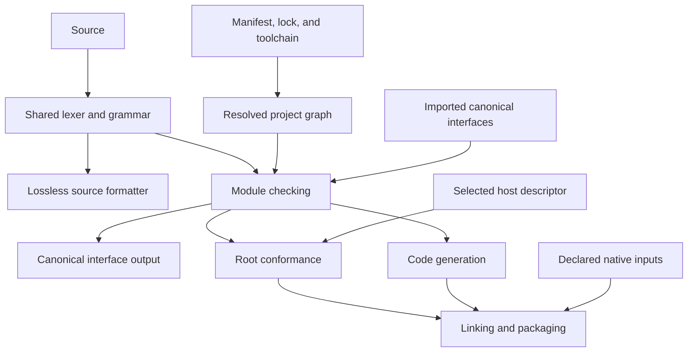

# Eldude tooling design

[Documentation map](index.md) · [Language tooling contracts](language-spec/12-interfaces-and-tooling.md) · [Existing formatter](formatter.md)

**Status:** Partially implemented tooling contract. The project foundation, source formatter, and experimental Python builds and test runners are delivered. Production hosts, native builds, remote resolution, complete canonical interfaces, and semantic incremental checking remain proposals. The [implementation guide](implementation.md#project-tooling) records the supported subset.

Eldude should provide one standard command for creating, checking, building, running, testing, and formatting projects. Ordinary projects use a declarative `eldude.toml`, a generated `eldude.lock`, and conventional source directories. Libraries remain host-independent; each executable or embedding configuration declares exactly one host.

This design covers the developer workflow, configuration model, compilation boundaries, formatting, dependency reproducibility, diagnostics, and integration points. It does not select a compiler backend or define a package registry service. The numbered language specification remains authoritative for language semantics; this document adds no source syntax or ownership, effect, or lifetime rule.

The current repository provides the project foundation, an experimental Python checker/interpreter, and a source formatter. An explicitly experimental `python::experimental` host additionally supports checked-IR builds, application execution, and isolated test runners. It is separate from the proposed production `cli::standard` host. Complete canonical interfaces, semantic incremental checking, production hosts, native builds, and remote resolution remain future work. Current executable commands and limits are documented in the [root README](../README.md#project-cli) and [implementation guide](implementation.md#project-tooling).

## Contents

- [Goals and precedents](#goals-and-precedents)
- [Project model](#project-model)
- [Manifest and configuration](#manifest-and-configuration)
- [Hosts and machine targets](#hosts-and-machine-targets)
- [Command line workflow](#command-line-workflow)
- [Dependencies and locking](#dependencies-and-locking)
- [Compilation and incremental work](#compilation-and-incremental-work)
- [Formatting](#formatting)
- [Diagnostics and integrations](#diagnostics-and-integrations)
- [Architecture and implementation boundaries](#architecture-and-implementation-boundaries)
- [Acceptance criteria](#acceptance-criteria)
- [Delivery sequence and deferred work](#delivery-sequence-and-deferred-work)

## Goals and precedents

The common path should be understandable from the project directory and its manifest. Opening a project in an editor, checking it locally, and building it in CI should select the same source, dependencies, toolchain, and root contracts. A private implementation edit should cause local work, and formatting should remain usable while the program has type errors.

The design borrows specific practices rather than reproducing another toolchain wholesale:

| Precedent | Practice adopted for Eldude |
| --- | --- |
| [Cargo](https://doc.rust-lang.org/cargo/guide/why-cargo-exists.html) | A shared project and dependency model behind everyday commands. |
| [Gleam](https://gleam.run/documentation/command-line-reference/) | Checking, building, formatting, and editor support delivered as one coherent toolchain. |
| [Go formatting](https://go.dev/doc/effective_go#formatting) | A canonical community style maintained by a standard formatter. |
| [uv project files](https://docs.astral.sh/uv/concepts/projects/layout/) | A clear separation between human-authored requirements and generated dependency resolutions. |
| [rustup overrides](https://rust-lang.github.io/rustup/overrides.html) | A repository can select an exact development toolchain. Eldude places that selection in its project manifest. |
| [Zig builds](https://ziglang.org/learn/build-system/) | Explicit machine targets and artifact dependencies. A programmable build language is deferred until concrete native integration needs justify it. |

Three approaches were considered. A compiler-only interface integrates easily with other build systems but leaves ordinary users to assemble a workflow. A programmable build system accommodates unusual pipelines but makes project inspection and caching depend on executing configuration. The selected approach is an integrated command with declarative configuration and machine-readable integration points.

Initial success means that a developer can create an application or library, understand its configuration, obtain precise diagnostics, format it consistently, and repeat a build using recorded inputs. A public registry, remote cache, plugin marketplace, and arbitrary build scripts are not prerequisites.

## Project model

### Modules, packages, targets, and workspaces

| Concept | Responsibility |
| --- | --- |
| Module | One source file with one declared logical module identity, following [§5.1](language-spec/01-foundations.md#51-one-module-per-source-file). |
| Package | A named, versioned collection of modules and direct dependencies, described by one manifest. |
| Application target | An exported entry function and an explicit host, producing a runnable application. |
| Embedding target | Exported entry functions and an explicit host, producing artifacts for an enclosing application. |
| Test target | An explicitly registered test runner and host; its code uses ordinary Eldude declarations. |
| Workspace | An explicit set of local packages sharing a lockfile, development toolchain, and build directory. |

These are build concepts. They do not add a package namespace to source syntax or change module-level visibility.

### Layout and source discovery

A generated application has this shape:

```text
hello/
  eldude.toml
  eldude.lock          # generated on first dependency resolution
  src/
    main.eld
  tests/               # present when a test runner is created
  build/               # generated and ignored by version control
```

The default source directory is `src`; the default test directory is `tests`. Explicit manifest overrides accommodate existing repositories. The build directory is always `build` under the workspace root, or package root outside a workspace. The first version has no configurable source globs or arbitrary output directory.

Source discovery recursively indexes `.eld` files in the declared source directories. Paths select files; `module` declarations determine their identities. For example, `src/main.eld` may declare `module hello;`. Moving that file within the source directory does not rename the module. Generated templates follow predictable paths without making paths a second semantic identity.

Nested directories containing their own `eldude.toml` form package boundaries and are excluded from the parent's discovery. Tool-owned build directories and dependency caches are excluded. Source and test roots must remain within the package after path normalization, must not overlap each other, and must not resolve inside the build directory or a nested package. Discovery does not traverse symlinked directories.

All modules in a package's source directory are available to its direct dependents, subject to ordinary `pub` visibility. There is initially no second manifest-level export list. Test-directory modules are available only when checking or running that package's tests. Tests can also use entries declared beside production source; they receive no extra access to another module's private declarations.

Only declared direct dependencies and the bundled standard library supply external imports to a package. A dependency's own imports use its own dependency environment. Public re-exports preserve their defining identities and do not make every transitive module directly importable.

Two providers of the same logical module identity in a selected dependency graph are an error. The diagnostic names both providers. Import order and search-path order never select a winner. Side-by-side versions that export conflicting module identities need a separate future design.

### Workspace membership and discovery

Workspace membership is explicit and uses paths relative to the root manifest:

```toml
manifest-version = 1

[workspace]
members = ["packages/geometry", "apps/viewer"]

[toolchain]
version = "0.1.0"
```

A workspace root may also contain a `[package]`; that package is a member in addition to the listed paths. Member names and normalized member paths must be unique. Members must be inside the workspace root, and nested workspace ownership is rejected. A workspace list does not create dependency edges: members still declare path dependencies on one another.

Commands discover the nearest enclosing manifest. A containing workspace owns a package only when its member list includes that package. Invocations from a workspace root select all members; invocations from a member select that member. `--workspace` selects all members, while `--package NAME` selects one member. The two selectors cannot be combined. `--manifest-path PATH` selects the starting manifest explicitly and follows the same ownership rules.

The root owns `eldude.lock`, `[toolchain]`, and `build/`. A member cannot silently override the workspace toolchain or lockfile. Its package compatibility requirement still applies. Formatting follows the same package selection rules as checking.

## Manifest and configuration

### Application manifest

The example versions below illustrate the manifest schema. The production `cli::standard` host remains proposed; runnable Python applications use `python::experimental` as documented in the [project CLI guide](../README.md#experimental-python-builds).

```toml
manifest-version = 1

[package]
name = "hello"
version = "0.1.0"
eldude = ">=0.1.0, <0.2.0"

[toolchain]
version = "0.1.0"

[[app]]
name = "hello"
entry = "hello::main"
host = "cli::standard"

[dependencies]
geometry = { path = "../geometry" }
```

The final component of `entry` names an exported function; preceding components name its module. Entry lookup uses the package's own modules. It does not infer a root from the filename or search dependencies for a function named `main`.

A library has a `[package]` and may have dependencies and a toolchain pin. It omits application and embedding targets. A package can contain both reusable modules and executable targets without duplicating its dependencies.

### Supported fields

| Field | Meaning and default |
| --- | --- |
| `manifest-version` | Required manifest schema major version; initially `1`. Unsupported versions are configuration errors. |
| `package.name` | Required package identifier: an ASCII letter or underscore followed by letters, digits, or underscores. It does not implicitly prefix module names. |
| `package.version` | Required semantic version of the package. |
| `package.eldude` | Optional supported compiler version constraint; checked for every resolved package. Omission adds no declared version constraint. |
| `package.source-dir` | Package-relative source directory; defaults to `src`. |
| `package.test-dir` | Package-relative test directory; defaults to `tests`, which may be absent. |
| `toolchain.version` | Optional exact development toolchain version, owned by the package or workspace root. Generated projects include it. |
| `app[].name`, `app[].entry`, `app[].host` | Required application name, exported root, and host identity. |
| `embed[].name`, `embed[].exports`, `embed[].host` | Required embedding name, nonempty exported function list, and host identity. |
| `test[].name`, `test[].entry`, `test[].host` | Required test runner name, exported root, and host identity. |
| `dependencies` | Direct dependencies used by production modules and targets. |
| `dev-dependencies` | Additional dependencies available to test targets and test-directory modules. |
| `workspace.members` | Explicit member directories; no implicit recursive membership or globs. |

Target names use the package identifier grammar and are unique across all target kinds within a package. Source files may define multiple roots, but target declarations determine which integrations are built. A manifest must define a package, a workspace, or both; target declarations require a package.

Version constraints initially accept an exact semantic version or a comma-separated conjunction of `=`, `>=`, `>`, `<=`, and `<` comparisons against full semantic versions. A bare version means exact equality. Wildcards, unions, and caret or tilde shorthand are outside version 1. Prereleases require an explicit prerelease reference in the constraint. This keeps compatibility intent readable before adding shorthand.

TOML duplicate keys, unknown fields, invalid values, missing required fields, and conflicting selectors are errors with manifest spans. There is no executable configuration, environment interpolation, include chain, or third-party extension section in the initial schema. Manifest edits made by future tooling must preserve unrelated fields and comments.

### Toolchain and configuration precedence

The package version identifies its release. `package.eldude` states compiler compatibility. `toolchain.version` pins the toolchain used to work on the repository, including its formatter and bundled standard library. These are separate facts. A dependency's development pin never selects the consumer's compiler.

Version 1 checks a declared pin against the running toolchain and reports a mismatch before checking, building, running, testing, or formatting project source. Read-only metadata inspection remains available so that it can report the mismatch. The tool does not silently install or switch toolchains. An explicit future installation workflow can add that convenience while preserving the project pin. Projects without a pin use the running toolchain, whose identity is included in build metadata.

For the settings that have command-line overrides, explicit flags override manifest defaults. Paths in manifests resolve relative to their declaring manifest; command-line paths resolve relative to the invocation directory. Diagnostic and metadata output show the resulting project and target selection.

Machine-local preferences may control presentation, cache location, and credentials. They may not change dependency origins, source membership, hosts, compiler semantics, or optimization behavior. Native environment inputs used by a build must be declared and recorded rather than read through an unrestricted global compiler-flags variable.

Source editions and independently selectable formatter editions are deferred. An exact toolchain pin provides a concrete starting point for reproducible formatting; future compatibility schemes must preserve the distinction between source semantics and layout.

## Hosts and machine targets

### Explicit root declarations

Every application, embedding target, and executable test runner declares a host. A missing `host` is a configuration error, including when the intended host is the standard CLI host. `eldude new` writes the declaration rather than relying on a hidden default. There is no global fallback host or command-line host override in version 1.

This follows the language's [host model](language-spec/10-host-and-ffi.md#48-host-model). A host defines startup and entry compatibility, external service implementations, scheduler/event integration, lifecycle ownership, and relevant native trust contracts. It is build metadata, not an implicitly passed value or capture.

Ordinary semantic checking runs first. Root conformance then verifies the selected integration against the already-typed root, as specified by [§58.7](language-spec/11-formal-semantics.md#587-root-hostembedding-conformance). Host selection cannot erase effects, satisfy missing trait constraints, change usage permissions, extend lifetimes, or authorize unsafe operations.

An embedding configuration uses the same model:

```toml
[[embed]]
name = "editor_plugin"
exports = ["plugin::start", "plugin::stop"]
host = "desktop::plugin"
```

This is a target fragment within a package manifest. The named host provider must also be available. The host describes the required export contracts and output artifact kinds; the tool does not assume that every embedding is a shared library or promise a stable binary ABI without an explicit ABI contract.

### Host providers

Host identities resolve to descriptors bundled with the selected toolchain or exported as metadata by a declared direct dependency. Bundled host identities are reserved and cannot be shadowed. Missing, ambiguous, or unsupported providers are errors. A custom provider is versioned and locked through the ordinary dependency mechanism.

A descriptor records its identity and format version, entry/export requirements, supported machine targets, runtime and native artifacts, service and scheduling contracts, and audited native metadata. Reading it is a data operation and does not execute provider code. Its machine representation belongs with the canonical native metadata required by [§74.4](language-spec/12-interfaces-and-tooling.md#744-canonical-native-binding-metadata); declaring a host does not establish that its native implementation has been audited.

Built-in `cli::standard` is the proposed first production host. Its initial template entry is an exported, nongeneric, nullary function returning `Int`. The host maps normal results from 0 through 255 to process exit status; other results reach the host's defect boundary. Arguments, I/O services, cancellation, and scheduling remain governed by the versioned host and library contracts. This profile is separate from the current fixture runner's `Int`/`Nat`/`Bool`/`Unit` convention.

### Machine target and profile

The host chooses runtime integration. `--target` chooses architecture, operating system, and ABI. A custom desktop host and the standard CLI host may each support several machine targets. A supported machine target alone does not imply that every host or native dependency can run there.

The default machine target is the current machine, normalized to a concrete target identifier and reported in build metadata. An explicit unsupported host/target combination fails before code generation. Cross-compilation requires the corresponding runtime, linker, and SDK inputs; the CLI does not imply that these are already installed.

There are initially two profiles: `dev`, selected by default, and `release`, selected by `--release`. Development prioritizes compilation speed and debugging. Release prioritizes optimized artifacts while retaining source-level guarantees, including required defects, cleanup, initialization ordering, and effect and ownership contracts. Custom profiles and flags that weaken language guarantees are excluded from version 1.

## Command line workflow

### Core commands

| Command | Contract |
| --- | --- |
| `eldude new PATH` | Create a conventional application with an explicit standard CLI host and a pin to the running toolchain. |
| `eldude new PATH --lib` | Create a library package without an application host. |
| `eldude init` | Create the corresponding manifest and missing starter files in the current directory; `--lib` selects a library. |
| `eldude check` | Perform static checks and applicable root-conformance checks; skip code generation, linking, and execution. |
| `eldude build` | Check and build the selected production modules, applications, and embeddings. |
| `eldude run` | Build one selected application and run that exact artifact. |
| `eldude test` | Check and execute the selected explicit test runners, with scoped results. |
| `eldude fmt` | Format the selected packages' authored source and test directories. |
| `eldude lock` | Reconcile the dependency graph with the manifest while retaining compatible locked selections. |
| `eldude update [DEPENDENCY]` | Deliberately reconsider the selected dependency, or all dependencies when none is named. |
| `eldude clean` | Remove generated artifacts under the owning project's `build/`; preserve sources, manifests, locks, and the shared download cache. |

`new` and `init` do not overwrite existing files. They validate the destination before writing, create only the needed starter files, and do not fetch dependencies, create a Git repository, or install editor settings. A generated application includes this source:

```eldude
module hello;

pub fn main() -> Int {
    0
}
```

The package/module name is substituted consistently. A library template contains its module declaration without inventing an API. Starter creation writes a build-directory ignore rule only when it can create a new `.gitignore`; an existing ignore file is left for an explicit, reviewable edit.

`clean` operates only on the derived build location for the discovered project. It refuses a symlinked build root and never follows links into source or dependency directories. Package and target selectors do not narrow `clean` in version 1; it clears the owning project's build outputs and reports that scope.

### Selection and checking scope

Bare `check` checks every source module and test module in the selected packages, including unused declarations, and validates all declared roots. An absent default test directory is not an error. It can therefore detect mistakes that an application-only build would not reach.

Bare `build` checks all production modules and builds all application and embedding targets in the selected packages. For a library it produces canonical interfaces and backend compilation products; it does not imply a stable native archive ABI. It excludes test-directory code and test-only dependency edges from compilation and linkage.

`--app NAME`, `--embed NAME`, or `--test NAME` selects a particular root for commands that support that kind. A root selector requires one selected package and is mutually exclusive with the other root selectors. `check` accepts all three; `build` accepts application or embedding selection; `run` accepts application selection; `test` accepts test selection. Targeted checking/building covers the root's dependency closure, not unrelated modules. Output explicitly reports that narrower scope.

`check PATH.eld` checks an ordinary module and its imports without requiring an application entry or host. Inside a project it uses that package's declared dependency environment; outside a project it uses adjacent source and bundled standard-library modules. This mode does not claim to validate an executable. Ad hoc single-file application execution is deferred; `run` requires a declared target.

File selection cannot be combined with package, workspace, or root selectors. Production modules retain their production dependency environment even when reached through a test; placing an entry beside source does not let production source import a test-only dependency.

When exactly one application is selected, `run` uses it. Zero or multiple applications produce a diagnostic listing the selection and, where needed, requesting `--app NAME`. The first declared application is never an implicit winner. Arguments after `--` are passed unchanged to the host's application argument interface. A cross-compiled artifact is not run unless its host declares a supported local launch adapter.

### Tests

Tests remain a tooling/library convention under [§78](language-spec/12-interfaces-and-tooling.md#78-testing), without new `test` or `expect` syntax. Version 1 starts with explicit executable runners:

```toml
[[test]]
name = "unit"
entry = "hello_tests::main"
host = "cli::standard"
```

The test module can call ordinary assertion or testing library functions when those APIs exist. The initial runner protocol uses process status: zero succeeds; nonzero status or a defect fails. Each runner executes in an isolated process using its declared host. Automatic function discovery, snapshots, and property-test interfaces can later build on this boundary.

Bare `test` checks all selected package source and test modules and all declared roots before running the test targets. Required compilation failures prevent a globally successful result. A specifically selected runner may run when unrelated modules are broken, provided its own dependencies check; its summary identifies that limited scope. An empty selection reports `No test targets selected`, with zero executed tests, rather than claiming that tests passed.

Application `run` and test runners start in their package directory, independent of the shell's invocation directory. Launch adapters preserve application arguments and expose cancellation to the host's lifecycle protocol. Child output is not mistaken for compiler diagnostics.

## Dependencies and locking

### Dependency sources

The initial deliverable supports path dependencies. The manifest also reserves explicit source forms for subsequent remote resolution:

```toml
[dependencies]
geometry = { path = "../geometry" }
codec = { version = ">=1.2.0, <2.0.0", registry = "https://packages.example.invalid" }
adapter = { git = "https://example.invalid/adapter.git", rev = "0123456789abcdef0123456789abcdef01234567" }
```

The remote URLs and revision above are illustrative. Each dependency selects exactly one source form. A path dependency may additionally specify a version constraint, which is checked against the local package. A Git dependency requires a full immutable commit identifier; branch and tag names are not supported in version 1 of that source form. Registry dependencies name their origin explicitly and do not fall back to another registry after a lookup failure.

Dependency keys name packages and must match their declared package names; package renaming is deferred. An ordinary dependency must be present in `[dependencies]` even if it is also a workspace member. A package cannot declare the same key in both dependency tables. Development dependencies are available to the declaring package's tests and are not inherited by consumers.

The first resolver selects one source and version for each package name across the owning project or workspace. Conflicting origins or incompatible constraints fail with the requirement chains that caused them. Path packages are identified by normalized locations and their declared identity. Package dependency cycles are rejected in the initial project model; this is a tooling restriction and does not prohibit the language's supported cycles between modules within a package.

Unsupported source forms produce an implementation-limit diagnostic. A path-only release must not appear to support registry or Git dependencies merely because it can parse their configuration.

### Lockfile contents and ownership

`eldude.lock` is generated, deterministic, human-readable TOML. It records a lock format version, resolver version, package identities, resolved versions and origins, immutable Git revisions where applicable, archive content digests, and dependency edges, including their production/test classification. It covers the whole owning workspace, even when a command builds one member.

Both application repositories and library repositories commit their lockfile. A library's lockfile fixes its own development and test graph; its consumers resolve from that library's declared requirements. The consumer does not import the library's development pin or lockfile.

Path dependencies remain editable source. Their lock entries record their location, identity, and dependency requirements, while build fingerprints record current source contents. An unchanged lockfile therefore does not imply unchanged local code. Paths are recorded relative to the owning root; a dependency outside the workspace makes that filesystem relationship an explicit portability requirement.

Host packages use the same locked source identities. The selected toolchain identifies bundled standard-library and host versions. Native SDKs and linker inputs are recorded as build inputs; they are not silently represented as ordinary source-package versions.

### Resolution and network behavior

Ordinary `check`, `build`, `run`, and `test` reuse valid locked selections. When the lock is absent or requirements have changed, they use the same reconciliation operation as `lock`, preserving compatible entries and reporting any changes. Reconciliation never upgrades an unaffected package merely because a newer version is available. A lock is replaced atomically only after the complete resolution and source verification succeed.

The full graph is resolved for lockfile consistency, but source downloads are limited to inputs needed for resolution or the selected operation. With a valid lock, a production-only build need not download unrelated test packages. Package metadata used during resolution is verified against its declared origin, and downloaded source content is verified before compilation.

`update DEPENDENCY` unlocks that package and the dependencies that must change to satisfy its new selection; unrelated compatible entries remain pinned. Bare `update` reconsiders all entries. Resolution against identical inputs and the same registry metadata is deterministic. Source selection is never a side effect of formatting or reading project metadata.

| Mode | Lockfile changes | Network access |
| --- | --- | --- |
| Normal | Allowed when needed to reconcile requirements | Allowed for missing declared inputs |
| `--locked` | Forbidden; missing or stale lock is an error | Allowed to obtain the exact locked inputs |
| `--offline` | Allowed if all necessary resolution data and sources are already cached | Forbidden |
| `--locked --offline` | Forbidden | Forbidden |

The distinction follows the useful separation in [Cargo's manifest options](https://doc.rust-lang.org/cargo/commands/cargo-build.html#manifest-options). Offline mode is not itself a reproducibility guarantee. An unavailable locked source fails clearly rather than selecting a different cached version.

Downloads are checked against recorded identities and digests before use. Package archives must not write outside their extraction directory. Credentials are kept outside manifests, locks, diagnostics, and build records. Version 1 does not execute dependency install hooks, build scripts, or compiler plugins. Native integration consumes declared artifacts and metadata.

## Compilation and incremental work

### Pipeline and semantic boundary

The project layer resolves source and dependency identities. The compiler checks a module against its own source and the canonical interfaces of its direct imports. Root conformance validates applications and embeddings separately. Code generation and linking consume checked results and explicitly recorded native inputs.



`check` stops before code generation and linking. It still validates declarations and generic bodies, including bodies unused by the selected application. Checking does not run user initializers, host startup, tests, or dependency code. Producing imported interfaces may require checking dependency source, but the importing module's semantic judgment must not consult those implementation bodies.

The boundary is specified by [§71](language-spec/12-interfaces-and-tooling.md#71-separate-compilation), including complete interface facts under [§72](language-spec/12-interfaces-and-tooling.md#72-canonical-semantic-interfaces). Generic specialization remains optional optimization under [§73](language-spec/12-interfaces-and-tooling.md#73-generic-compilation).

Interface readers validate format compatibility, declaration identities, and semantic metadata before admitting imported contracts. Interface producers verify exported guarantees against their defining modules. Deserializing a cached object is not itself evidence that its usage, capture, or native promises are valid.

Module cycles and top-level initialization preserve [§5.2](language-spec/01-foundations.md#52-declaration-only-top-level), including deterministic dependency-component order and startup defects. Build scheduling cannot change evaluation order or turn a runtime initialization defect into an implementation-dependent source rejection.

### Cache dependencies

The cache distinguishes the dependency classes required by the language:

| Dependency class | Examples of invalidating changes |
| --- | --- |
| Semantic interface | Public types, effects, captures, usage permissions, trait headers, termination facts, audited semantic FFI contracts. |
| Optimization | A body used for inlining or specialization. |
| ABI and layout | Exported representation, calling convention, or target-dependent layout. |
| Generated binding | Binding-generator version or the inputs from which a binding was produced. |
| Host and native trust | Root integration, scheduler assumptions, native adapter contracts, or referenced native artifacts. |

Every cache entry also identifies the compiler build, relevant format versions, configuration, source inputs, and applicable machine-target/profile facts. An input change invalidates only the products that depend on it. Target-dependent semantic facts belong in semantic keys; target-independent results may be shared only when those facts are unchanged.

A private body edit rechecks its module. If the resulting canonical interface hash is unchanged, downstream semantic checks are reused. Downstream optimization products may still rebuild if they consumed the body. A formatter-only edit may refresh local source locations, but it must not change the semantic interface or force downstream semantic rechecking. Cached diagnostics must never report stale locations after an edit.

Changing an audited native semantic contract can invalidate semantic clients even when the native symbol and binary layout are unchanged. Changing an application host rechecks root conformance and affected native/code-generation products; it does not by itself alter ordinary library validity.

Initial semantic invalidation uses the whole canonical module interface hash. More granular tracking of individual exported facts is an optimization to add only after measurements justify it. The tool should be able to explain a rebuild using the dependency class and changed input. It must not label all source changes as an undifferentiated cache miss.

### Artifacts and reproducibility

Generated outputs live under `build/<target>/<profile>/`, with package and target identities separating artifacts. Internal cache filenames are not a public API. Successful builds report artifact paths through the human summary and machine event stream. External tools obtain paths from metadata or events instead of assuming a backend-specific directory structure.

Writes to cached products and final artifacts use temporary files and atomic replacement. Concurrent invocations coordinate shared outputs; failed or cancelled builds cannot publish an incomplete artifact as valid. A previous complete artifact may remain on disk, but a failed `run` build never launches it as if it were current. Deleting the build directory must change performance only, never correctness.

The reproducibility target is identical outputs from identical declared inputs using the same toolchain, backend, machine target, profile, and native environment. This requires stable ordering and control of embedded paths, timestamps, linker behavior, and SDK inputs as well as a dependency lock. Different operating systems or unrecorded system libraries are not implicitly equivalent environments.

Build records include the effective toolchain, graph identity, hosts, machine target, profile, and native input identities. They contain no credentials. Remote artifact caches, signed provenance, and guarantees across distinct toolchain releases are outside the initial delivery.

## Formatting

### Source contract and style

The [formatter guide](formatter.md) records source layout and preservation. The project CLI reuses that formatter. The normative requirement remains [§77](language-spec/12-interfaces-and-tooling.md#77-formatting-and-source-stability).

Formatting uses syntax alone. It accepts the full ordinary source grammar, including constructs beyond the interpreter subset and code whose imports or types are invalid. It does not resolve dependencies, execute source, infer contracts, or require a lockfile. Project invocations validate the project selection and toolchain pin. Explicit paths check any owning project's pin; stdin checks the invoking project's pin when present. Both modes remain available without a manifest and then use the running formatter.

The canonical style retains four-space indentation, LF layout newlines, one final newline, and the current 100-column target. Indivisible expressions, comments, and literal contents can exceed that target. There are no project style options, formatter plugins, ignore directives in source, or separate formatter configuration file in version 1.

Every non-whitespace token retains its spelling and order. Comment text and placement retain the guarantees of the existing formatter. Formatting does not sort imports, reorder effects, add separators, rewrite literals, or apply refactorings. Generated semantic interfaces have their own canonical ordering and are rendered distinctly from author-written source under §77; they are not ordinary `.eld` formatter input.

The formatter is deterministic and idempotent for a fixed toolchain. Formatting changes arrive through an explicit toolchain upgrade and a reviewable source diff.

### Commands and selection

| Invocation | Behavior |
| --- | --- |
| `eldude fmt` | Rewrite source and test files in the selected project packages. |
| `eldude fmt --check` | Check the same selection without writing. |
| `eldude fmt FILE...` | Rewrite explicitly selected files. |
| `eldude fmt DIRECTORY...` | Recursively format authored `.eld` files under the explicit directories. |
| `eldude fmt --diff` | Print a unified diff for the selection without writing. |
| `eldude fmt -` | Read one source from stdin and print formatted source to stdout. |

No-argument formatting requires a discoverable project; it does not silently switch to stdin. `--check` and `--diff` are mutually exclusive. Either may apply to stdin as a sole input; stdin is never mixed with filesystem inputs. Explicit paths cannot be combined with package/workspace selectors or `--manifest-path`; they select exactly the requested filesystem scope. If that scope crosses projects, all applicable pins must match the running formatter before any write begins.

Automatic and directory selections exclude nested package boundaries, dependency caches, generated build directories, and symlinked directories. Formatting an owning workspace includes its members through their declared source directories. An explicit symlinked file is rejected for write mode. Repeated file identities are deduplicated and results are reported in stable path order.

`eldude-format` prints to stdout by default. The project CLI's `eldude fmt` writes files by default and supports explicit stdin/stdout operation. Both commands and the source API retain their documented behavior.

### Write guarantees

Before a multi-file write, the formatter reads, parses, and formats every selected file. A syntax, encoding, selection, or read error at that stage leaves all inputs untouched. Changed files are then replaced atomically, preserving permissions; unchanged files retain their file identity and timestamp.

Each replacement rejects detected symlinks and checks that the input bytes and permission bits still match the preflight snapshot. A change detected by those checks causes that file to fail. The checks and replacement are separate operations, so a concurrent edit, permission change, or symlink substitution after a check can still race with replacement; writers requiring exclusion must coordinate access. An I/O failure during replacement can occur after earlier files were written: the command reports those completed writes and the failure. The guarantee is atomic replacement per file, not exclusion of concurrent writers, a filesystem-wide transaction, or automatic rollback.

Check and diff modes return 0 when all input is already formatted, 1 when changes are needed, and 2 on invalid input or operational failure. Successful write/stdout modes return 0; their failures return 2. Write and check modes list changed paths; diff mode emits a unified diff. Plain `fmt -` emits only formatted source to stdout. Diagnostics go to stderr.

## Diagnostics and integrations

### Human diagnostics

Compiler diagnostics use the source-level terms required by [§76](language-spec/12-interfaces-and-tooling.md#76-diagnostics). A useful ownership, capture, or effect diagnostic identifies the violated obligation, its origin, and the shortest relevant retention or control path. It should explain a constraint in language terms rather than present internal solver state as the primary message.

Configuration diagnostics follow the same pattern: identify the manifest field or dependency edge, show conflicting declarations when present, and give a concrete corrective action. Unsupported implementation features are distinguished from invalid Eldude programs and invalid project configuration.

Human progress and diagnostics go to stderr. Application stdout remains application stdout. Plain output is available without color or terminal control sequences. A completed command summarizes what was selected, what succeeded, and what failed; a selected target passing is never presented as whole-workspace success.

| Command outcome | Exit status |
| --- | --- |
| Successful checking, building, locking, or tests | `0` |
| Source/root-contract rejection or failed tests | `1` |
| Invalid configuration, invocation, unsupported implementation capability, or operational failure | `2` |
| Formatting difference in check/diff mode | `1`, as defined above |
| Successfully launched application | The application's exit status; launch/build failures retain tool diagnostics and the statuses above. |

Formatter parse failures retain the existing formatter's error status `2`. Compiler parse failures are source rejection status `1`. Internal tool failures use status `2` with an explicit internal-error category and no success summary. Cancellation follows the platform's interruption convention and is reported separately from a failed assertion or language diagnostic.

### Machine interfaces and editors

`eldude metadata` emits one versioned JSON document describing the effective project selection, package/module locations, dependency edges, declared roots and host providers, toolchain, and known artifacts. It reads manifests, the existing lock, and available local metadata without fetching, resolving new versions, or executing code. If the graph is incomplete, it reports that state and its unresolved inputs rather than fabricating a resolved graph. Invalid manifests still fail.

`eldude interface MODULE` checks the selected module as needed and prints its deterministic human-readable canonical interface, labeled as generated interface notation. Public capture, usage, cleanup, effect, and native contracts must be visible under [§72.7](language-spec/12-interfaces-and-tooling.md#727-human-readable-semantic-interface-rendering). Ordinary source stubs and complete semantic interfaces are not interchangeable. This command uses the same lock/network controls as checking.

`check`, `build`, and `test` support `--message-format=json`. Their stdout becomes a UTF-8 stream of newline-delimited JSON events, with no human progress mixed into it. Each event identifies its schema version and event kind. Events cover diagnostics, artifact production, test results, and a final summary. Diagnostic records contain a code/category, severity, message, primary and related spans, notes, and any validated suggested edit. Source ranges use zero-based, half-open Unicode scalar offsets into decoded source; lines and columns are one-based, with columns also counting Unicode scalars. Editor adapters translate to their negotiated position encoding.

Test-runner stdout/stderr is captured and represented as labeled output events in machine mode. Direct `run` does not accept machine event mode in version 1, avoiding ambiguity with arbitrary application streams. JSON schema major changes require a new version; consumers may ignore unknown additive fields and event kinds. Human wording and internal cache layouts are not machine APIs.

The future `eldude lsp` uses the same project resolver, semantic checker, diagnostics, and formatter with an unsaved-file overlay. It does not invoke a different checker or independently reinterpret the manifest. An editor can show unresolved dependencies without executing dependency code or silently changing the lockfile. A permanently running build daemon is not required for the first CLI.

## Architecture and implementation boundaries

The implementation should keep responsibilities separate without creating a plugin framework:

| Component | Responsibility and boundary |
| --- | --- |
| CLI and project model | Parse arguments/manifests, select packages and roots, validate configuration, and present results. |
| Resolver and source store | Produce a deterministic graph, verify sources, own lockfile updates, and enforce network mode. |
| Language frontend | Parse and check ordinary modules; expose complete canonical interfaces and located diagnostics. |
| Root validator | Validate already-typed roots against host descriptors without changing library typing. |
| Build executor | Schedule compiler/backend/linker work and maintain correctly keyed artifacts. |
| Source formatter | Format lossless syntax using the shared lexer and grammar, independently of semantic checking. |
| Integration adapters | Render terminal/JSON/LSP results without duplicating semantic decisions. |

The backend is replaceable behind checked inputs and declared artifact outputs. The design does not choose LLVM, C emission, another native backend, or a production runtime strategy. Native support must demonstrate its advertised contracts before `build` claims to produce a supported executable.

The [implementation file map](implementation.md#file-map) identifies the components to reuse. In particular, `source/modules.py` owns declared module identities, `source/pipeline.py` provides the current check/execute path, `source/syntax.py` supplies located syntax and diagnostics, and `tooling/format.py` already implements source preservation and safe writes. Their corresponding tests are part of any future implementation change.

The current `compile_source`/`compile_file` APIs return checked programs for interpretation; their names do not imply native code generation. Existing interface serialization experiments do not establish a complete, validated canonical-interface cache. Host fixture support does not establish a production CLI host. Each capability remains explicitly labeled until its acceptance evidence exists.

## Acceptance criteria

Acceptance is defined by observable behavior and independent expected results. These scenarios cover the full tooling contract. The project, path resolver, formatter, static checking, and experimental Python build/test subset have [implementation tests](implementation.md#file-map); production hosts, native execution, remote source verification, and semantic caching still require acceptance evidence.

| Area | Required evidence |
| --- | --- |
| Project creation | Application and library templates parse; application metadata names its host; existing files survive failed `new`/`init` attempts. |
| Configuration | Unknown keys, malformed versions, missing hosts, invalid source roots, ambiguous selections, and toolchain mismatches point to the responsible input. |
| Discovery | Module identity survives file moves; duplicate providers fail deterministically; undeclared transitive imports fail; package boundaries are respected. |
| Workspaces | Root/member/explicit selection behaves consistently across check/build/test/fmt; one root lock and toolchain apply. |
| Static checking | Libraries check without `main` or a host; unused and generic bodies are checked in the documented scope; no initializer or application code executes. |
| Root conformance | Missing services, invalid entry contracts, unsupported host/target combinations, and insufficient scheduling/native contracts reject the target without changing library validity. |
| Native build and run | A small `.eld` application checks, builds, and runs with its independently expected result; debug and release preserve required results, defects, and cleanup behavior. |
| Selection | A valid selected target can be checked despite unrelated errors; summaries do not claim whole-project success. Failed rebuilds never run stale artifacts. |
| Dependency locking | A repeated build preserves the lock; incompatible requirements fail; deliberate updates have bounded changes; locked/offline modes honor both controls. |
| Source verification | Wrong digests, missing offline sources, unsafe archive paths, and origin conflicts fail without publishing a successful lock or artifact. |
| Incremental checking | A private body edit preserves downstream semantic work when the interface hash is unchanged; public effect/capture/usage changes invalidate semantic clients. |
| Native metadata | Changing an audited semantic contract invalidates semantic dependents even with unchanged ABI; changing only an optimization body does not re-typecheck clients. |
| Cache correctness | Clean and cached builds agree; target/toolchain/profile changes do not reuse incompatible artifacts; interrupted/concurrent builds publish only complete products. |
| Formatting | Golden layouts, token/comment preservation, idempotence, unresolved-import/type-error inputs, full-source-grammar coverage, and stable ordering pass. |
| Formatter writes | Syntax failure before writing changes nothing; permissions and unchanged files survive; detected stale bytes, changed permissions, and symlinks reject replacement; partial I/O failures are accurately reported. |
| Tests and diagnostics | Test hosts are explicit; runner outcomes and empty selection are reported accurately; terminal and machine diagnostics describe the same obligations and scope. |

For every implemented language or library capability needed by tooling, first add small `.eld` acceptance programs and run them through the source parser, checker, and interpreter. Expected results come from the language contract. Ownership, lifetime, effect, and constraint boundaries require rejection programs that reach the intended diagnostic. Retain these in the [example corpus](../examples/README.md) and its tests. Python-only checks or `pending` examples do not establish completion.

Project and filesystem behavior additionally needs temporary-project CLI tests. Native backends require the same relevant source programs to execute through the native path, including result/event/cleanup comparisons where applicable. Formatting continues to use the existing before/after execution and rejection checks. Cache tests inspect actual reuse/invalidation as well as final results, so a correct result obtained by rechecking everything does not satisfy the incremental contract.

Performance measurements should distinguish cold builds, warm no-op checks, private-body edits, public-interface edits, and formatting. Record project size, toolchain, machine, and native inputs before setting latency budgets. The design promises correct reuse boundaries, not unmeasured speed claims.

Use the [repository verification commands](../README.md#checks) for implementation changes. Update supported-subset documentation only after the corresponding acceptance evidence passes.

## Delivery sequence and deferred work

The project foundation is delivered, including library checking without an execution root, structured diagnostics, and experimental Python artifacts and isolated test runners. Remaining work follows dependencies between capabilities:

1. **Semantic boundaries:** complete canonical-interface validation/rendering, production host root-conformance checks, and correct semantic invalidation.
2. **Native applications:** one production `cli::standard` host and one supported machine target, development/release artifacts, argument/exit handling, and isolated executable test runners. Native acceptance establishes native `build` and `run` support.
3. **Broader integrations:** custom host descriptors and embeddings, additional machine targets, registry/Git sources with verified locks, and editor integration using the established project model.

A release advertises the capabilities it implements and rejects unsupported ones explicitly. Parsing a target or dependency field is not evidence that its runtime, backend, or resolver works. No stage relaxes the language's semantic contracts to obtain apparent feature coverage.

Public registry operation and publishing policy, arbitrary build scripts, compiler plugins, user-defined profiles, dependency feature-flag systems, remote build caches, automatic toolchain downloads, source editions, and formatter style options are deferred. Their absence keeps the first project model reviewable and the dependency graph inspectable.

Separate designs are required before delivering the complete production CLI host service/lifecycle contract, the custom-host descriptor wire format and native adapter packaging, or a registry protocol. Those designs must fit the root-conformance, source-verification, and reproducibility boundaries specified here. They must not introduce ambient host selection or change the agreed `eldude` command name.
